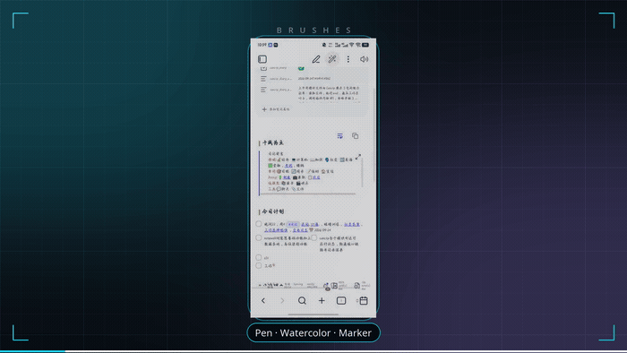
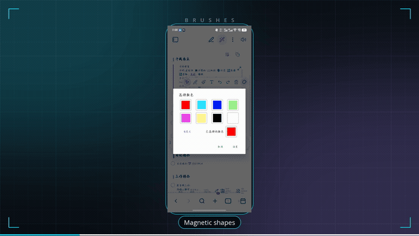
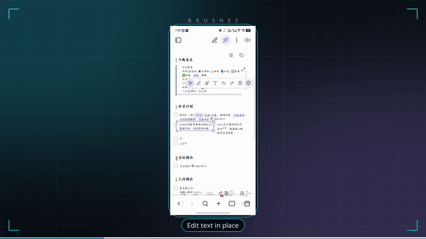
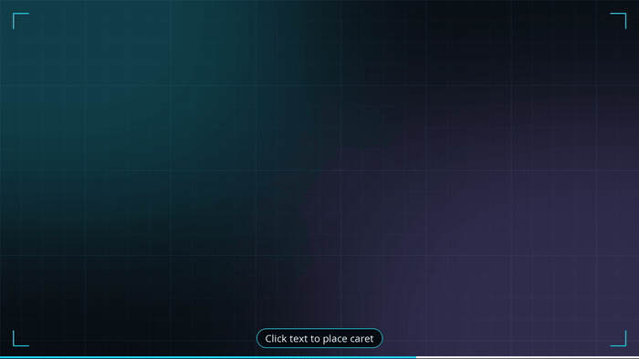

# NoteDraw

NoteDraw is a plugin for editing rendered note text and drawing directly on notes.

It is built as a surface layer: the same drawing and text-edit logic works on Obsidian reading view, source view, embedded note previews, and supported webview surfaces.

## Demo

**Brushes — pen, watercolor and marker.** Stroke width follows your hand speed.



**Shapes — magnetic rectangles, circles and three-point arrows.**



**Text — edit rendered Markdown in place, then restyle it.**



**Draw without the wand — your ink becomes part of the note.**



## Features

- Magic-wand header button for entering NoteDraw mode.
- In-place text editing in reading view.
- Source/edit view overlay using the same command entry.
- The original pen remains the default, with a separate speed-sensitive fountain pen that varies stroke width while keeping opacity stable.
- Reading view adds a note pen that uses fountain-pen dynamics while reserving clean Markdown flow space beneath the stroke.
- The original watercolor brush remains available, with text-aligned and auto-straight variants.
- Stroke selection, multi-select, movement, resize handles, and delete.
- Floating text, magnetic rectangles and circles, and three-point curved arrows.
- Text style toggles for bold, italic, underline, and boxed text.
- Text, rectangles, circles, and arrows are grouped under one Text and links section.
- Text and shape tools can select existing drawing elements before creating new ones.
- Text elements can be double-clicked to edit again, and text-panel style buttons apply to active rendered Markdown text when possible.
- Circular toolbar buttons sized for quick touch or mouse use.
- Palette changes recolor selected elements directly; without a selection, select mode keeps the palette closed.
- Selected elements can be copied and pasted across notes with styles, assets, layering, and bound connectors intact.
- The active tool, brush variant, text preset, zoom, color, width, opacity, and mind-map link choice persist across notes and restarts.
- Active pen and watercolor buttons use their current brush color as the button background.
- The palette has common color swatches plus an advanced color picker entry, and applies color changes to selected elements.
- Toolbar positioning stays below the Obsidian view header while scrolling.
- Lazy drawing-data loading to reduce note-open lag.
- Drawing files are keyed by a hash of the full note path, so notes whose
  names differ only in non-ASCII characters no longer share one drawing file.
- The draw tool keeps the canvas free of selection frames and resize handles;
  a press that misses the selected element releases it and draws in one gesture.
- Viewport-windowed canvas rendering with mobile pixel budgets for stable long-note performance.
- Inactive canvases stay out of the compositor, and stale view controllers are released on mode or file changes.
- Hidden Obsidian embed copies are not mounted, and offscreen embeds pause scroll-driven layout work until they approach the viewport.
- Runaway historical element coordinates are bounded and repaired instead of stretching a note to an unusable height.
- Responsive coordinates follow the Markdown content lane and nearby source lines across reading, source, desktop, and mobile layouts.
- Reading view uses non-reflowing visual zoom: original line breaks stay fixed, enlarged content can overflow horizontally, and two-axis panning keeps every NoteDraw layer aligned.
- Source/edit view keeps layout zoom, so text can reflow to the edited working width.
- Click-to-caret behavior inside active text blocks.
- Configurable drawing storage, with the plugin config folder remaining the default.
- Portable single-file sharing that keeps normal Markdown readable while embedding NoteDraw data and linked resources in a hidden block.
- Public API for scripts, other plugins, and AI agents.
- Drawings made inside embedded note previews are stored against the embedded note path, so opening that note shows the same layer.
- Embedded `![[Markdown notes]]` can be edited in place: direct editing in source view and the floating format toolbar in reading view.
- Webview surfaces get independent drawing files, so annotations do not bleed between pages.
- File-backed Canvas, PDF, image, database, and other workspace views retain their magic wand and drawing layer across internal rerenders.
- Imported images, videos, files, Markdown, and HTML can be placed as floating NoteDraw elements.
- Markdown files can be converted into rendered, editable NoteDraw mind maps with visible embeds, magnetically bound curved connectors, optional source-note updates, and source-note navigation.

## Storage

By default, new drawing files are stored here:

```text
<vault>/.obsidian/plugins/notedraw/drawings/
```

Drawing files are named after the note path plus a 64-bit hash of that path, for
example `nd-1a2b3c4d5e6f7g.json`. The hash is what keeps one note's ink from
appearing on another note: older builds derived the file name by replacing every
non-ASCII character with `_`, so `生活/身体/舞蹈.md` and `生活/身体/运动.md` both
became `____________.md.json` and shared a single drawing file. Names produced by
those builds are still read, but only when the JSON's own `sourcePath` names the
note being opened, and the data is copied to the new name on first access. The
old files are left in place.

The **NoteDraw data location** setting provides four choices:

- Plugin config folder (default): `<vault>/.obsidian/plugins/notedraw/drawings/`
- Current note folder / `notedraw`: `<note-folder>/notedraw/<note>.notedraw.json`
- Current note folder: `<note-folder>/<note>.notedraw.json`
- Current Markdown file: a hidden, compressed NoteDraw block appended to the note

Changing the setting preserves old data and copies the active note's current drawing into the selected location. NoteDraw can still read existing config-folder, embedded, and legacy data and uses the newest valid copy.

With the default config-folder mode, imported attachments are saved beside the current note. If enabled, NoteDraw appends only their hidden link metadata to the Markdown file so the attachments remain associated with the note. Drawing data and ordinary Markdown links stay out of the note.

**Share NoteDraw file** is available in the note menu and command palette. It creates a uniquely named `<note>.notedraw.md` copy containing the readable Markdown body plus a hidden portable bundle with the drawing layer, NoteDraw attachments, internal linked files, and reachable HTTP/HTTPS resources. NoteDraw opens that copy in Obsidian reading view and waits for its Markdown, resources, and drawing layer to render before opening system sharing. The source note and existing copies are never overwritten. Normal Markdown readers ignore the hidden block; NoteDraw restores it when the file is opened in a compatible Obsidian environment.

## Migration

Version `3.5.7` is the initial NoteDraw experiment and uses plugin id:

```text
notedraw
```

If an older local prototype folder exists, NoteDraw can read its previous drawing JSON files and copy them into the new `notedraw/drawings` folder on first access. The old files are not deleted.

## Manual Install

Copy these files into:

```text
<vault>/.obsidian/plugins/notedraw/
```

Required files:

```text
main.js
manifest.json
styles.css
```

Then enable:

```text
Settings -> Community plugins -> Installed plugins -> NoteDraw
```

## Source Build

NoteDraw now keeps source code under `src/` and builds the Obsidian runtime file at the repository root.

```bash
npm install
npm run build
```

Build output:

```text
main.js
```

The release package still uses the standard Obsidian plugin layout:

```text
main.js
manifest.json
styles.css
```

The source tree keeps `extras/` for support-code images used at build time. Release builds embed those images into `main.js`, so the installed plugin does not require separate image files.

## Settings

The settings page currently includes:

- Default pen color, width, opacity.
- Default watercolor color, width, opacity.
- UI language.
- NoteDraw data location.
- Toolbar top offset.
- Long-press delay, tap tolerance, selection hit padding, and selected-element opacity.
- Stroke smoothing, input sampling, save compaction, and auto-save delay.
- Reset buttons for brush defaults and layout/interaction defaults.
- Debug log toggle for troubleshooting text targeting.
- Two fixed support QR codes shown from bundled assets with embedded fallback.

## Extension API

NoteDraw exposes a small API from the plugin instance:

```js
const api = app.plugins.plugins.notedraw.api;
```

For convenience, it is also exposed while the plugin is loaded:

```js
const api = window.NoteDraw;
```

Stable integration API (recommended for Cancip, scripts, and AI plugins):

```js
const noteDraw = api.v1;

noteDraw.apiVersion;       // "1.0"
noteDraw.capabilities;
noteDraw.listSurfaces();
await noteDraw.getState();
await noteDraw.activate({ tool: "edit-md" });
await noteDraw.toggle();
await noteDraw.setVisibility(true);
noteDraw.setTool("pen");
noteDraw.setTool({ tool: "draw", brush: "pen", variant: "fountain" });
noteDraw.setTool({ tool: "draw", brush: "watercolor", variant: "text-highlight" });
noteDraw.setBrush({ brush: "pen", variant: "fountain", color: "#e53935", width: 4, opacity: 0.9 });
noteDraw.setTextPreset("rectangle");
noteDraw.setZoom(1.25);
await noteDraw.selectElements({ ids: ["element-id"] });
await noteDraw.updateElements({ ids: ["element-id"], patch: { color: "#43a047", locked: true } });
await noteDraw.reorderElements({ ids: ["element-id"], direction: "front" });
await noteDraw.undo();
await noteDraw.readDrawings("Notes/example.md");
const bundle = await noteDraw.drawingData.read("Notes/example.md", {
  includeResources: true,
  includeMarkdownLinks: true
});
const hiddenBlock = await noteDraw.drawingData.serialize(bundle, { format: "block" });
const restoredBundle = await noteDraw.drawingData.parse(hiddenBlock);
await noteDraw.writeDrawings("Notes/example.md", drawingData);
await noteDraw.replaceText({
  path: "Notes/example.md",
  originalText: "old rendered text",
  editedText: "edited **Markdown** text"
});
await noteDraw.insertStroke("Notes/example.md", stroke);
await noteDraw.createElements({
  elements: generatedStrokes,
  surface: { owner: "cancip", id: "workbench" }
});
await noteDraw.highlightRegion({
  surface: { owner: "cancip", id: "workbench" },
  region: { basis: "surface-normalized", x: 0.1, y: 0.2, width: 0.4, height: 0.08 },
  page: 2
});
await noteDraw.insertInk({
  surface: { owner: "noteweb", id: "page" },
  region: { basis: "surface-pixel", x: 80, y: 120, width: 240, height: 90 },
  points: [{ x: 0, y: 0.1 }, { x: 1, y: 0.9 }],
  pointBasis: "region-normalized",
  noteFlow: true
});
await noteDraw.focusRegion({
  surface: { owner: "noteweb", id: "page" },
  region: { x: 0.25, y: 0.55, width: 0.2, height: 0.1 }
});
await noteDraw.updateSurfaceSource({
  owner: "cancip",
  id: "workbench",
  format: "docx",
  mediaType: "application/vnd.openxmlformats-officedocument.wordprocessingml.document",
  path: "Exports/example.docx"
});
const unsubscribe = noteDraw.on("markdown-changed", (event) => console.log(event));
await noteDraw.execute("set-tool", { tool: "select" });
```

`drawingData.read/parse/serialize` is the placement-neutral integration API for temporary exports. It only returns data and does not create, modify, move, or delete Vault files or change NoteDraw's storage setting. The calling plugin decides whether to embed the serialized block in a Markdown copy, save JSON beside a note, use a subfolder, or keep the result in memory. `parse` reads standard bundle objects, JSON, hidden blocks, and complete Markdown containing a hidden block. The older `writeDrawings` method remains available separately for integrations that explicitly intend to change NoteDraw data.

Region editing uses normalized surface coordinates by default. `surface-pixel` regions are converted using the registered surface size; ink points can be `region-normalized` to stay local to the selected region. Optional location fields (`page`, `slide`, `sheet`, `frame`, `layer`, `range`, and `sourceId`) are preserved for external editors. The advertised source formats are `html`, `web`, `pdf`, `docx`, `xlsx`, and `pptx`. `highlightRegion` creates a highlight stroke, `insertInk` creates a freehand or NoteFlow stroke, `focusRegion` delegates to the host viewport when available, and `updateSurfaceSource` changes the source identity without requiring Cancip or NoteWeb to know NoteDraw's storage layout.

Custom views from Cancip, NoteWeb, or another plugin can register their visible surface without copying NoteDraw internals:

~~~js
const surface = noteDraw.registerSurface({
  owner: "noteweb",
  id: "tab:" + leaf.id,
  host: webPageContainer,
  source: {
    kind: "url",
    url: currentUrl,
    title: documentTitle
  },
  capabilities: {
    drawing: true,
    textEditing: true,
    elements: true,
    attachments: true
  },
  viewport: {
    getZoom: () => browserZoom,
    setZoom: (zoom) => setBrowserZoom(zoom),
    getScroll: () => ({ left: webPageContainer.scrollLeft, top: webPageContainer.scrollTop }),
    onChange: (callback) => subscribeToViewport(callback)
  }
});

await surface.ready;
await surface.activate("draw");
await surface.execute([
  { op: "set-brush", brush: "watercolor", variant: "text-highlight", color: "#facc15" },
  { op: "insert-elements", elements: generatedStrokes }
]);

surface.destroy();
~~~

Registering the same owner and id again updates its source on the same host. Vault paths, normalized URLs, and virtual keys receive separate persistent drawing storage. The returned handle exposes surface-scoped drawing, text, element, clipboard, history, mind-map, zoom, event, refresh, and lifecycle operations without exposing NoteDraw's internal controller.

The structured methods cover surface state, visibility, tools, brush settings, text presets, element selection and mutation, layers, locking, note flow, history, clipboard, settings, imports, exports, and lifecycle events. `execute(action, options)` accepts a string, one structured action object, or an ordered action array, so Cancip and other agents do not depend on internal controller method names.

Magic-wand actions are maintained on Markdown, Canvas, PDF, image, Base/database, HTML/webview, and other supported main-workspace pages. State-backed plugin pages use a stable NoteDraw storage identity even when they do not expose a Vault file.

Obsidian's built-in global and local graph views remain native interactive surfaces: NoteDraw does not automatically wrap their canvases or input handlers. Plugins can still opt a custom region into NoteDraw explicitly through `api.v1.registerSurface()`.

The original top-level methods remain available for compatibility.

Example: read current note drawings.

```js
const file = app.workspace.getActiveFile();
const drawings = await app.plugins.plugins.notedraw.api.v1.readDrawings(file);
console.log(drawings.strokes.length);
```

Example: insert a stroke.

```js
const file = app.workspace.getActiveFile();
await app.plugins.plugins.notedraw.api.v1.insertStroke(file, {
  brush: "pen",
  color: "#e53935",
  width: 3,
  opacity: 1,
  points: [
    { x: 0.2, y: 0.2 },
    { x: 0.5, y: 0.35 },
    { x: 0.7, y: 0.6 }
  ]
});
```

Example: AI-assisted text replacement.

```js
const file = app.workspace.getActiveFile();
await app.plugins.plugins.notedraw.api.v1.replaceText({
  file,
  originalText: "old rendered text",
  editedText: "edited Markdown text"
});
```

## AI Editing

The API is intentionally plain JSON and string based so local AI agents can:

- Read drawing layers.
- Insert generated marks, highlights, or review strokes.
- Replace selected or matched text.
- Build higher-level commands such as summarize, rewrite, annotate, or highlight.

For safety, AI tools should read first, prepare a small patch, then write only the target note or drawing file.

## Web Surface Direction

NoteDraw is structured around controllers bound to visible note surfaces. That makes future support practical for:

- Obsidian reading view.
- Obsidian source/edit view.
- Obsidian Publish or web-like rendered note pages.
- External AI or browser automation that talks through the public API.

The current package focuses on the local Obsidian plugin runtime. The API and DOM controller split are the extension points for broader web support.

## Version

Current version: `4.1.2`.

### 4.1.2 — elements stop moving on their own

Everything drawn floats in the note document, but the projection that maps saved
geometry onto the current canvas treated it like text: it re-anchored elements to
the nearest Markdown line and it scaled their height with the document and the
viewport. So editing one element, opening a side pane, or the note simply getting
taller moved ink that nobody touched.

- Floating elements now project in absolute document coordinates: the Markdown
  line map is ignored and their size follows the content-lane width only.
- Text anchoring still runs — exactly once — when the note's own text changed or
  the content lane really reflowed, then the result is captured as the new
  absolute position. NoteFlow ink keeps its line anchors, since it genuinely
  reserves space inside the Markdown flow.
- "Text changed" is decided by hashing the note's text, not by file mtime/size:
  NoteDraw writes hidden blocks into notes, so stats change without any edit.
- A layout repair or geometry capture on a transient frame (mid view switch,
  split pane, keyboard) is skipped instead of baking that frame into the drawing.
- Element points additionally store their absolute document row (`docY`) next to
  the relative anchor, so same-lane height changes cannot scale them.

### 4.1.1 — restore tools after 4.1.0

- Fixes a regression in 4.1.0 that made every pointer press throw: the new
  `selectionFrameVisible` helper was placed on the plugin class while the
  drawing controller — the only caller — had it undefined, so pen, select and
  text tools all stopped responding. A new test (`controller-scope.test.mjs`)
  fails the build if the controller ever calls a helper that lives on the plugin.

### 4.1.0 — drawing identity and draw-tool selection

- Drawing files are now named with a path hash. Before this, every note whose
  name had the same number of non-ASCII characters shared one drawing file, so
  ink drawn on one note appeared on unrelated notes and the last writer won.
  Existing files are still read when their `sourcePath` matches, then copied to
  the new name. Renaming or moving a note now carries its ink along.
- The previous revision of a drawing file is kept beside it as `*.json.bak`, so
  a half-finished write no longer reads back as an empty note.
- The draw tool no longer paints the dashed element frame or its resize handles;
  they belong to the select tool. Dragging a selected element still shows the
  frame for feedback.
- With an element selected, a press that misses it releases the selection and
  keeps drawing in the same gesture. A plain tap on empty space simply
  deselects, and with nothing selected every press inks as before.

